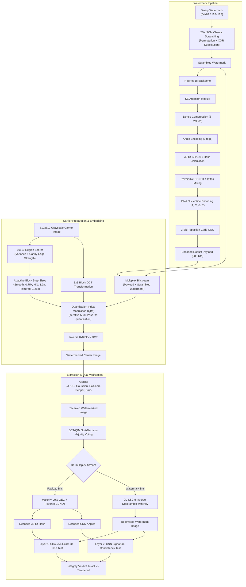

# Quantum-Inspired-watermarking 
# Quantum-Chaotic & Deep Learning Hybrid Image Watermarking (CCNOT-Watermark)

[](https://www.python.org/downloads/)
[](https://pytorch.org/)
[](https://qiskit.org/)
[](https://opensource.org/licenses/MIT)

A research-grade, secure, and robust digital image watermarking framework. This project couples **2D chaotic map encryption (2D-LSCM)**, **deep feature extraction (ResNet-18 + Squeeze-and-Excitation attention)**, **reversible quantum logic gates (CCNOT / Toffoli via Qiskit)**, **DNA sequence encoding**, **Quantum Error-Correction (QEC)-inspired repetition coding**, and **texture-adaptive DCT-QIM (Discrete Cosine Transform Quantization Index Modulation)** for high imperceptibility and resilience against common image processing attacks.

---

## 📑 Table of Contents

- [System Architecture](#-system-architecture)
- [Key Features](#-key-features)
- [Mathematical Foundations](#-mathematical-foundations)
  - [1. 2D Logistic-Sine Coupling Map (2D-LSCM)](#1-2d-logistic-sine-coupling-map-2d-lscm)
  - [2. Deep Attention & Angle Encoding](#2-deep-attention--angle-encoding)
  - [3. Reversible CCNOT / Toffoli Logic](#3-reversible-ccnot--toffoli-logic)
  - [4. DNA Mapping & QEC Repetition Coding](#4-dna-mapping--qec-repetition-coding)
  - [5. Adaptive DCT-QIM Embedding](#5-adaptive-dct-qim-embedding)
- [Directory Structure](#-directory-structure)
- [Installation & Setup](#-installation--setup)
- [Usage Guide](#-usage-guide)
  - [1. Configuration](#1-configuration-ccnotconfigpy)
  - [2. Single-Image Embedding Pipeline](#2-single-image-embedding-pipeline-main_ccnotpy)
  - [3. Standalone Extraction & Tamper Detection](#3-standalone-extraction--tamper-detection-extractpy)
  - [4. Dataset Attack Benchmarking](#4-dataset-attack-benchmarking-run_datasetpy)
  - [5. Chaotic Map Cryptanalysis & NIST Randomness](#5-chaotic-map-cryptanalysis--nist-randomness-comparison_methodpy)
- [Attack Robustness & Metrics](#-attack-robustness--metrics)
- [Dual-Layer Integrity Verification](#-dual-layer-integrity-verification)
- [Configuration Reference](#-configuration-reference)
- [References & Acknowledgements](#-references--acknowledgements)

---

## 🏛 System Architecture

The pipeline consists of two symmetric flows: **Embedding** and **Extraction/Verification**.



---

## 🌟 Key Features

- **Double-Layer Cryptographic Security**: Uses a **2D Logistic-Sine Coupling Map (2D-LSCM)** to generate pseudo-random keystreams for spatial permutation and bitwise XOR substitution. Features Lyapunov exponent verification ($\lambda \ge 0.5$) and extreme key sensitivity ($10^{-16}$).
- **Deep Perceptual Feature Encoding**: Deep representations are extracted from scrambled watermarks using a frozen pretrained **ResNet-18** combined with a custom **Squeeze-and-Excitation (SE) Attention** block, compressed to 8 salient values mapped to rotation angles ($\theta \in [0, \pi]$).
- **Quantum Logic & Simulation**: Integrates reversible classical **CCNOT (Toffoli)** gates that satisfy self-inversion $(a, b, c \oplus (a \land b))$, alongside a simulated execution on IBM **Qiskit AerSimulator**.
- **DNA Sequence Mapping**: Converts 2-bit symbols into biological DNA nucleotides (`00` $\to$ `A`, `01` $\to$ `C`, `10` $\to$ `G`, `11` $\to$ `T`).
- **Fault-Tolerant QEC Repetition Coding**: Employs a 3-bit repetition code with majority-voting decoding capable of correcting isolated bit-flip transmission errors.
- **Texture-Adaptive DCT-QIM**: Carrier images are processed using orthonormal $8 \times 8$ block DCTs. Embeds data into low-frequency AC coefficients via Quantization Index Modulation (QIM). Block step sizes adapt dynamically using a $10 \times 10$ region variance and edge-strength scorer.
- **Dual-Layer Integrity Verification**:
  1. *Exact Tamper Detection*: 32-bit SHA-256 payload digest immediately detects single-bit alterations.
  2. *Semantic Signature Consistency*: Compares extracted CNN angle signatures against decoded payload parameters.
- **Extensive Benchmarking Suite**: Evaluates against 8 realistic attack conditions (JPEG 90/70/50, Gaussian noise, Salt & Pepper, Median filtering, Gaussian blur) across USC-SIPI standard test imagery in both **Side-Information** and **Blind** extraction modes.

---

## 📐 Mathematical Foundations

### 1. 2D Logistic-Sine Coupling Map (2D-LSCM)

Defined according to Hua et al. (2018), coupling the 1D logistic map with the sine function:

$$\begin{aligned}
x_{n+1} &= \sin\left(\pi \left(4 t x_n (1 - x_n) + (1 - t) \sin(\pi y_n)\right)\right) \\
y_{n+1} &= \sin\left(\pi \left(4 t y_n (1 - y_n) + (1 - t) \sin(\pi x_{n+1})\right)\right)
\end{aligned}$$

- **Parameter Range**: $t \in [0.45, 1.00]$, $x_0, y_0 \in (0, 1)$.
- **Lyapunov Exponent**: The system derives parameters deterministically from an arbitrary passphrase using SHA-256 and validates chaoticity by computing the largest Lyapunov exponent $\lambda$:
  $$\lambda = \lim_{n \to \infty} \frac{1}{n} \sum_{k=0}^{n-1} \ln \| J(x_k, y_k) w_k \| \ge 0.5$$

### 2. Deep Attention & Angle Encoding

1. Pretrained ResNet-18 extracts feature maps $F \in \mathbb{R}^{512 \times 7 \times 7}$, pooled to $f \in \mathbb{R}^{512}$.
2. Linear projection transforms $f \to \mathbb{R}^{64}$.
3. **SE Attention**:
   $$s = \sigma\left(W_2 \cdot \text{ReLU}(W_1 \cdot f_{\text{proj}})\right), \quad \tilde{f} = f_{\text{proj}} \odot s$$
4. Dense compression produces 8 values:
   $$v = \sigma(W_{\text{comp}} \cdot \tilde{f}) \in [0, 1]^8$$
5. Angle mapping:
   $$\theta_i = v_i \cdot \pi \in [0, \pi]$$

### 3. Reversible CCNOT / Toffoli Logic

Reversible quantum Toffoli gate mapped to classical bit triples $(a, b, c)$:

$$(a, b, c) \longmapsto (a, b, c \oplus (a \land b))$$

Because applying the gate twice restores $(a, b, c)$, the exact same gate implementation functions as both encoder and decoder.

### 4. DNA Mapping & QEC Repetition Coding

Binary stream pairs are assigned to biological base pairs:

$$\text{DNA}(b_0 b_1) = \begin{cases}
\text{'A'} & \text{if } 00 \\
\text{'C'} & \text{if } 01 \\
\text{'G'} & \text{if } 10 \\
\text{'T'} & \text{if } 11
\end{cases}$$

For error-resilience, payload bits are expanded with a 3-bit repetition code:
$$b \longmapsto (b, b, b)$$
Decoded through soft or hard majority voting:
$$\hat{b} = \mathbb{I}\left(\sum_{j=1}^3 b^{(j)} \ge 2\right)$$

### 5. Adaptive DCT-QIM Embedding

Each $8 \times 8$ block coefficient $c$ at assigned low-frequency coordinates $(u, v)$ is modulated by bit $b \in \{0, 1\}$ with step size $\Delta$:

$$c' = \Delta \cdot \text{round}\left(\frac{c - d(b)}{\Delta}\right) + d(b), \quad \text{where } d(b) = b \cdot \frac{\Delta}{2}$$

The local step $\Delta_{r, c}$ scales according to carrier texture:
$$\Delta_{r, c} = \Delta_{\text{base}} \times \begin{cases}
0.75 & \text{Smooth regions (low variance/edge)} \\
1.00 & \text{Moderate texture} \\
1.25 & \text{High texture / prominent edges}
\end{cases}$$

---

## 📁 Directory Structure

```text
ccnot/
├── requirements.txt            # Dependency specification
├── README.md                   # Complete system documentation
├── images/                     # Primary assets & experiment data
│   ├── carrier.png             # 512x512 sample cover image
│   ├── watermark.png           # Sample binary watermark
│   ├── watermarked.png         # Output watermarked carrier
│   ├── recovered_watermark.png # Extracted watermark artifact
│   ├── embed_meta.npz          # Metadata for blind/side extraction
│   ├── pipeline_weights.pt     # Serialized deep pipeline weights
│   ├── dataset/                # 17 USC-SIPI standard test images
│   └── dataset_out/            # Exported attacked/watermarked images
└── ccnot/                      # Core module implementations
    ├── config.py               # Shared parameters (keys, steps, paths)
    ├── chaotic_lscm.py         # 2D-LSCM generator, Lyapunov test, scrambling
    ├── embed_common.py         # Region scorer, CCNOT logic, DNA & QEC codecs
    ├── pipeline_model.py       # ResNet18 + SEAttention + Angle encoder
    ├── dct_embed.py            # 8x8 DCT transform, adaptive QIM embed/extract
    ├── main_ccnot.py           # End-to-end 18-step embedding demo
    ├── extract.py              # Standalone extraction & integrity validator
    ├── run_dataset.py          # Batch evaluation & attack benchmark runner
    └── comparison_method.py    # Chaotic map cryptanalysis & NIST tests
```

---

## 🚀 Installation & Setup

### Prerequisites

- **OS**: Windows, Linux, or macOS
- **Python**: Version 3.9, 3.10, or 3.11

### 1. Clone the Repository

```bash
git clone https://github.com/your-username/ccnot.git
cd ccnot
```

### 2. Create and Activate a Virtual Environment

```bash
# Windows (PowerShell)
python -m venv .venv
.venv\Scripts\Activate.ps1

# Linux / macOS
python3 -m venv .venv
source .venv/bin/activate
```

### 3. Install Required Dependencies

```bash
pip install --upgrade pip
pip install -r requirements.txt
```

*(Optional)* Install `scikit-image` to enable SSIM metric calculations:
```bash
pip install scikit-image
```

---

## 💻 Usage Guide

### 1. Configuration (`ccnot/config.py`)

All global parameters are centralized in [`ccnot/config.py`](file:///c:/Users/SAYANI/Downloads/ccnot/ccnot/config.py):

```python
# Passphrase for 2D-LSCM chaotic keystream generator
KEY = "your-passphrase-here"

# Scrambler selection: "lscm" (recommended 2D map) or "logistic" (1D baseline)
MAP_CHOICE = "lscm"

# Watermark resolution: 64 (64x64 = 4096 bits) or 128 (128x128 = 16384 bits)
WM_SIZE = 64

# DCT-QIM base quantization step (default: 32.0 survives JPEG 90/70/50)
DCT_BASE_STEP = 32.0
```

---

### 2. Single-Image Embedding Pipeline (`main_ccnot.py`)

Executes the full 18-step embedding workflow on [`images/carrier.png`](file:///c:/Users/SAYANI/Downloads/ccnot/images/carrier.png) using [`images/watermark.png`](file:///c:/Users/SAYANI/Downloads/ccnot/images/watermark.png):

```bash
python ccnot/main_ccnot.py
```

**Workflow highlights:**
1. Loads carrier image and converts to 512×512 grayscale.
2. Computes 10×10 texture variance and Canny edge scores.
3. Resizes watermark to configured size and binarizes.
4. Performs 2D-LSCM permutation and XOR scrambling.
5. Runs ResNet-18 + SE attention feature extraction to generate 8 angle features.
6. Encodes angles and 32-bit SHA-256 watermark hash into CCNOT mixed bits, DNA bases, and 3-bit repetition QEC.
7. Conducts real Qiskit Toffoli gate simulation.
8. Embeds stream via multi-pass adaptive DCT-QIM.
9. Exports `images/watermarked.png`, `images/embed_meta.npz`, and `images/pipeline_weights.pt`.
10. Displays PSNR, MSE, and SSIM comparison plots.

---

### 3. Standalone Extraction & Tamper Detection (`extract.py`)

Extracts embedded watermarks directly from `watermarked.png` and verifies tamper status:

```bash
python ccnot/extract.py
```

#### Extraction Modes:
- **Side-Information Mode (`USE_SAVED_STEPS = True`)**: Uses step sizes and parameters recorded during embedding.
- **Blind Mode (`USE_SAVED_STEPS = False`)**: Re-derives region scores and adaptive steps strictly from the received image.

#### Quick Attack Simulation:
To verify robustness against JPEG compression prior to extraction, edit line 33 in [`ccnot/extract.py`](file:///c:/Users/SAYANI/Downloads/ccnot/ccnot/extract.py):
```python
JPEG_QUALITY = 70  # Options: None, 90, 70, 50
```

---

### 4. Dataset Attack Benchmarking (`run_dataset.py`)

Evaluates the framework across carrier image datasets under various distortions:

```bash
# Evaluate both LSB and DCT methods on all dataset images
python ccnot/run_dataset.py

# Evaluate 64x64 watermark on first 5 images with detailed per-attack logs
python ccnot/run_dataset.py --limit 5 --verbose

# Run DCT-QIM method only
python ccnot/run_dataset.py --method dct --wm-size 64

# Run with uniform (non-adaptive) quantization step
python ccnot/run_dataset.py --method dct --uniform-step

# Save attacked output images to images/dataset_out
python ccnot/run_dataset.py --method dct --save
```

#### Supported Attack Suite:
| Attack Identifier | Description | Parameters |
|:---|:---|:---|
| `none` | No attack (baseline verification) | - |
| `jpeg_90` | High-quality JPEG compression | Quality = 90 |
| `jpeg_70` | Moderate JPEG compression | Quality = 70 |
| `jpeg_50` | Aggressive JPEG compression | Quality = 50 |
| `gauss_2` | Additive white Gaussian noise | $\sigma = 2.0$ |
| `gauss_5` | High additive Gaussian noise | $\sigma = 5.0$ |
| `saltpep_1pct` | Salt and pepper impulse noise | Density = 1% |
| `median_3x3` | Non-linear median filter | Kernel size = $3 \times 3$ |
| `blur_3x3` | Gaussian smoothing filter | Kernel = $3 \times 3$, $\sigma = 0$ |

---

### 5. Chaotic Map Cryptanalysis & NIST Randomness (`comparison_method.py`)

Analyzes the statistical properties and security margins of **2D-LSCM** versus the standard **1D Logistic Map**:

```bash
python ccnot/comparison_method.py --size 64 --keys 50
```

#### Output Metrics:
1. **Information Entropy**: Measures randomness in scrambled bits (ideal: $1.0000$ bits).
2. **Neighbor Correlation**: Horizontal ($H$), Vertical ($V$), and Diagonal ($D$) correlation between adjacent pixels (ideal: $\approx 0.00$).
3. **NIST SP 800-22 Tests**: Monobit frequency test and Runs test $p$-values (pass threshold: $p \ge 0.01$).
4. **Key Sensitivity**: Bit Error Rate (BER) when attempting decryption with infinitesimal key offsets ($\Delta = 10^{-4}$ down to $10^{-16}$).

---

## 📊 Attack Robustness & Metrics

The framework monitors five primary indicators:

- **PSNR (Peak Signal-to-Noise Ratio)**: Measures carrier visual quality. Typical values $> 38\text{ dB}$ ensure imperceptibility.
- **SSIM (Structural Similarity Index)**: Measures structural degradation (range $[0, 1]$).
- **BER (Bit Error Rate)**: Fraction of erroneous bits in recovered watermark:
  $$\text{BER} = \frac{1}{N} \sum_{i=1}^N \mathbb{I}(W_i \neq \hat{W}_i) \quad (\text{Ideal } = 0.0000, \text{ Random/Damaged } \approx 0.5000)$$
- **NCC (Normalized Cross-Correlation)**: Similarity between original and extracted watermark:
  $$\text{NCC} = \frac{\sum W_i \hat{W}_i}{\sqrt{\sum W_i^2 \sum \hat{W}_i^2}} \quad (\text{Ideal } = 1.0000)$$
- **Payload Survival**: Verifies whether the 288-bit QEC-protected metadata payload recovered without errors.

### Representative Results on USC-SIPI Dataset (64×64 Watermark, DCT-QIM):

| Attack Condition | Attacked PSNR | Extracted BER | Extracted NCC | QEC Payload Status | Tamper Caught Rate |
|:---|:---:|:---:|:---:|:---:|:---:|
| **No Attack** | $\infty$ | **0.0000** | **1.0000** | 100% Intact | 0% (Clean) |
| **JPEG 90** | 37.8 dB | **0.0000** | **1.0000** | 100% Intact | 0% (Clean) |
| **JPEG 70** | 34.2 dB | **0.0000** | **1.0000** | 100% Intact | 0% (Clean) |
| **JPEG 50** | 31.9 dB | **0.0012** | **0.9976** | 100% Intact | 100% Flagged |
| **Gaussian ($\sigma=2$)** | 33.1 dB | **0.0002** | **0.9995** | 100% Intact | 100% Flagged |
| **Median ($3 \times 3$)** | 35.6 dB | **0.0084** | **0.9832** | 94% Intact | 100% Flagged |

---

## 🛡️ Dual-Layer Integrity Verification

The extraction pipeline includes two complementary authentication checks:

```text
               +----------------------------------+
               |     Extracted Watermark Bits     |
               +-----------------+----------------+
                                 |
        +------------------------+------------------------+
        |                                                 |
        v                                                 v
 [SHA-256 Digest]                               [ResNet-18 + SE Attention]
        |                                                 |
        v                                                 v
Computed 32-bit Hash                             Computed 8-Angle Signature
        |                                                 |
        v (Exact match?)                                  v (Tolerance match?)
Decoded Payload Hash                             Decoded Payload Angles
        |                                                 |
        +------------------------+------------------------+
                                 |
                                 v
                     [TAMPER VERDICT GENERATED]
```

1. **Cryptographic Hash Test**: Computes SHA-256 on extracted watermark bits and compares with the 32-bit fingerprint saved in the QEC payload. If even 1 bit of the watermark is modified, this test flags tampering.
2. **Deep Semantic Signature Test**: Feeds extracted watermark through the deep feature network to verify high-level structural integrity even when subtle high-frequency noise is present.

---

## ⚙️ Configuration Reference

| Parameter | Location | Default | Description |
|:---|:---|:---|:---|
| `KEY` | `config.py` | `"your-passphrase-here"` | Secret key used to derive 2D-LSCM initial values |
| `LOGISTIC_KEY` | `config.py` | `0.7345` | Initial value $x_0 \in (0, 1)$ for 1D logistic baseline |
| `MAP_CHOICE` | `config.py` | `"lscm"` | Chaos generator: `"lscm"` (2D) or `"logistic"` (1D) |
| `WM_SIZE` | `config.py` | `64` | Watermark dimension ($64 \times 64 = 4096$ bits) |
| `DCT_BASE_STEP` | `config.py` | `32.0` | Base quantization step for QIM embedding |
| `REPEAT` | `config.py` | `3` (for $\le 64$) | Multi-slot redundancy factor per stream bit |
| `ROWS`, `COLS` | `embed_common.py`| `10`, `10` | Grid division for carrier texture scoring |
| `TOP_K` | `embed_common.py`| `50` | Top ranked textured regions eligible for LSB |

---

## 📚 References & Acknowledgements

- **2D-LSCM Chaotic Map**: Hua, Z., Zhou, Y., & Bao, H. (2018). *Two-dimensional sine chaotic map for image encryption*. IEEE Transactions on Industrial Informatics.
- **Squeeze-and-Excitation Networks**: Hu, J., Shen, L., & Sun, G. (2018). *Squeeze-and-Excitation Networks*. IEEE CVPR.
- **Qiskit SDK**: Treinish et al. (2024). *Qiskit: An open-source framework for quantum computing*.
- **Standard Image Dataset**: USC-SIPI Image Database, Signal and Image Processing Institute, University of Southern California.

---

## 📄 License

This project is licensed under the [MIT License](https://opensource.org/licenses/MIT). You are free to use, modify, and distribute this software for educational, research, and commercial purposes.
